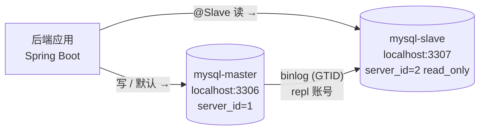

# MySQL 读写分离部署文档（Docker 主从复制 + Spring 数据源路由）

## 1. 文档目的与适用范围

本文对应课程要求：**后台数据库做读写分离**。全部演示依赖本机的 Docker，不需要虚拟机：

- 数据库层：用 Docker Compose 起两个 MySQL 8.4 容器，**GTID 异步主从复制**，主库写、从库读。
- 应用层：Spring Boot **双数据源 + 路由切面**，写与默认访问自动走主库，`@Slave` 标注的只读方法走从库。

前置条件：本机已安装 Docker Desktop（本仓库开发机为 `D:\Docker\Docker`，引擎 29.8.0）。

> 选型说明：读写分离的数据库部分用 Docker 双容器实现，好处是不依赖虚拟机、可一键重建、演示时启动即用。虚拟机上的 Tomcat 集群部分见 [Tomcat集群部署文档.md](./Tomcat集群部署文档.md)，两者互不影响。

---

## 2. 总体架构

### 2.1 拓扑



| 容器 | 宿主机端口 | 角色 | 关键参数 |
|------|-----------|------|----------|
| `mysql-master` | 3306 | 主库（写 + 默认访问） | `server-id=1`、`log-bin`、`gtid-mode=ON` |
| `mysql-slave` | 3307 | 从库（只读副本） | `server-id=2`、`read_only=ON`、`super_read_only=ON` |

编排文件：`deploy/docker/docker-compose.yml`。

### 2.2 读写路由规则

| 访问类型 | 路由 | 说明 |
|----------|------|------|
| INSERT / UPDATE / DELETE | 主库 | 未标注的数据访问默认落主库，写安全优先 |
| 普通查询（未标注） | 主库 | 默认行为，避免误配造成数据不一致 |
| Service 方法标注 `@Slave` | 从库 | 仅限可容忍主从延迟的只读方法 |
| 事务中的访问 | 主库 | 由事务拦截器前的切面优先级保证，见 6.3 |

### 2.3 请求链路

1. 请求进入后端应用。
2. 应用内切面判断：方法带 `@Slave` → 线程路由键置为 SLAVE；否则默认 MASTER。
3. `RoutingDataSource` 按路由键从主/从两个 HikariCP 连接池中取连接执行 SQL。
4. 主库上所有变更经 binlog 异步复制到从库；从库 `read_only=ON` 拒绝应用直写。

---

## 3. 启动 MySQL 主从容器

### 3.1 拉取镜像（国内网络）

Docker Hub 直连可能超时，用国内镜像源拉取并打回标准标签：

```bash
docker pull docker.1ms.run/library/mysql:8.4
docker tag docker.1ms.run/library/mysql:8.4 mysql:8.4
```

### 3.2 启动容器

```bash
# 在 deploy/docker 目录执行
docker compose up -d
docker compose ps          # 等两个容器都变成 healthy
```

首次启动时容器会按字母序自动执行初始化脚本：

| 脚本 | 作用 |
|------|------|
| `deploy/docker/master/01-users.sql` | 主库：建应用账号 `campus` 与复制账号 `repl` |
| `docs/sql/init.sql`（挂载为 `02-init.sql`） | 主库：导入 15 张业务表 |
| `deploy/docker/slave/01-users.sql` | 从库：单独建应用账号 `campus` |

验证主库参数与建表结果：

```bash
docker exec mysql-master mysql -uroot -pChangeMe_123 -e \
  "SELECT COUNT(*) FROM information_schema.tables WHERE table_schema='campus_repair';
   SHOW VARIABLES WHERE Variable_name IN ('server_id','gtid_mode','log_bin');"
```

预期：表数量 15；`server_id=1`、`gtid_mode=ON`、`log_bin=ON`。

> **端口必须空闲**：本机若装有 XAMPP / 独立 MySQL 服务（服务名常见为 `mysqlzt`），它会占用 3306 与 Docker 冲突。先停掉：
>
> ```bash
> net stop mysqlzt          # 需要管理员权限，或以管理员身份执行
> ```
>
> 若想保留该服务，改用第 9 章的自定义端口方案。

---

## 4. 建立复制链路

### 4.1 在从库指向主库并启动复制

容器在同一 Compose 网络内，直接以服务名 `mysql-master` 作为复制源主机名：

```bash
docker exec mysql-slave mysql -uroot -pChangeMe_123 -e "
  CHANGE REPLICATION SOURCE TO
    SOURCE_HOST          = 'mysql-master',
    SOURCE_USER          = 'repl',
    SOURCE_PASSWORD      = 'ChangeMe_Repl_123',
    SOURCE_AUTO_POSITION = 1,
    SOURCE_SSL           = 1;
  START REPLICA;"
```

- `SOURCE_AUTO_POSITION=1`：GTID 复制的关键，从库自动按缺失的 GTID 补数据，不用手抄 binlog 文件名和位点。
- `SOURCE_SSL=1`：MySQL 8 默认认证插件 `caching_sha2_password` 要求安全连接，不加会报 **错误 2061**。

### 4.2 复制状态验证

```bash
docker exec mysql-slave mysql -uroot -pChangeMe_123 -e "SHOW REPLICA STATUS\G" \
  | grep -E "Replica_IO_Running|Replica_SQL_Running|Seconds_Behind_Source|Last_Error"
```

| 字段 | 预期 | 含义 |
|------|------|------|
| `Replica_IO_Running` | Yes | 拉 binlog 的线程正常 |
| `Replica_SQL_Running` | Yes | 回放 binlog 的线程正常 |
| `Seconds_Behind_Source` | 0 | 主从延迟（秒） |
| `Last_Error` | 空 | 无回放错误 |

### 4.3 锁定从库为超级只读

复制建立后再开 `super_read_only`（连 root 也拦），避免误写从库。放在这一步而不是容器启动参数里，是因为首次初始化要用 root 建账号，提前开启会导致容器起不来：

```bash
docker exec mysql-slave mysql -uroot -pChangeMe_123 -e \
  "SET PERSIST super_read_only=ON;
   SELECT @@super_read_only AS super_ro, @@read_only AS ro;"
```

预期：`super_ro=1`、`ro=1`。

### 4.4 写主读从验证

```bash
# 主库写入
docker exec mysql-master mysql -uroot -pChangeMe_123 -e \
  "CREATE DATABASE IF NOT EXISTS rw_check; USE rw_check;
   CREATE TABLE IF NOT EXISTS t(id INT PRIMARY KEY); INSERT INTO t VALUES(1);"

# 从库读取（预期查到 id=1）
docker exec mysql-slave mysql -uroot -pChangeMe_123 -e "SELECT * FROM rw_check.t;"

# 清理（在主库执行，DROP 会随复制同步到从库）
docker exec mysql-master mysql -uroot -pChangeMe_123 -e "DROP DATABASE rw_check;"
```

若从库查不到，先回到 4.2 看两个线程是否为 Yes、`Last_Error` 是什么。

---

## 5. 应用侧实现（代码已入库）

### 5.1 新增类清单

| 类 | 位置 | 职责 |
|----|------|------|
| `DataSourceKey` | `datasource/` | 路由键枚举：MASTER / SLAVE |
| `DynamicDataSourceContextHolder` | `datasource/` | ThreadLocal 保存当前线程路由键，默认 MASTER |
| `RoutingDataSource` | `datasource/` | 继承 `AbstractRoutingDataSource`，按路由键选连接池 |
| `Slave` | `datasource/` | 标注只读 Service 方法，路由到从库 |
| `SlaveDataSourceAspect` | `datasource/` | `@Aspect` 切面：`@Slave` 方法执行前切从库，finally 清理 |
| `DataSourceRoutingConfig` | `config/` | 构建主/从两个 HikariCP 池并注册路由数据源（条件装配） |

### 5.2 路由流程

```text
Controller
   └─> Service 方法（@Slave?）
         ├─ 无标注 ──────────────> ThreadLocal = MASTER（默认）
         └─ @Slave ─ 切面设置 ──> ThreadLocal = SLAVE
               └─> RoutingDataSource.determineCurrentLookupKey()
                     ├─ MASTER ─> masterDataSource（localhost:3306）
                     └─ SLAVE  ─> slaveDataSource （localhost:3307）
```

### 5.3 为什么切面优先级必须最高

JPA 在**事务开启时**就申请数据库连接。若切面晚于 `@Transactional` 执行，事务已经拿着主库连接，从库路由不会生效。因此 `SlaveDataSourceAspect` 标注 `@Order(Ordered.HIGHEST_PRECEDENCE)`，保证路由键先于事务拦截器设置。同理，`@Slave` 只能标注在 **Service 层公开方法**上（内部 `this` 调用不走代理，切面不生效）。

> 切点写法用 `@annotation(com.example.campusrepair.datasource.Slave)` 且**不绑定注解参数**。Spring Boot 4 下若写成 `@annotation(slave)` 并额外声明 `Slave slave` 形参，运行时会抛 `Required to bind 2 arguments, but only bound 1`。

### 5.4 配置项

`application-prod.properties`（密码经环境变量注入，不入库）：

```properties
# 读写分离开关；未开启时沿用 spring.datasource.* 单数据源，本地开发不受影响
app.datasource.routing-enabled=true

# 主库（写 + 默认访问）
spring.datasource.master.jdbc-url=jdbc:mysql://${DB_HOST:localhost}:${DB_PORT:3306}/campus_repair?...
spring.datasource.master.username=${DB_USERNAME:campus}
spring.datasource.master.password=${DB_PASSWORD:ChangeMe_123}
spring.datasource.master.maximum-pool-size=10

# 从库；jdbc-url 留空则读操作自动回落主库（应用可先于从库上线）
spring.datasource.slave.jdbc-url=jdbc:mysql://${DB_SLAVE_HOST:localhost}:${DB_SLAVE_PORT:3307}/campus_repair?...
spring.datasource.slave.username=${DB_USERNAME:campus}
spring.datasource.slave.password=${DB_PASSWORD:ChangeMe_123}
spring.datasource.slave.maximum-pool-size=10
```

> 绑定 `HikariDataSource` 时属性名是 `jdbc-url` 而不是 `url`，这是 Hikari 的 setter 命名（`setJdbcUrl`），写成 `url` 不会报错但连接池拿不到地址。

本机 Docker 演示时用环境变量覆盖端口（主 3306 / 从 3307）：

| 变量 | 本机演示值 | 说明 |
|------|-----------|------|
| `SPRING_PROFILES_ACTIVE` | `prod` | 启用生产配置 |
| `DB_HOST` / `DB_PORT` | `localhost` / `3306` | 主库 |
| `DB_SLAVE_HOST` / `DB_SLAVE_PORT` | `localhost` / `3307` | 从库 |
| `DB_USERNAME` / `DB_PASSWORD` | `campus` / `ChangeMe_123` | 应用账号 |

### 5.5 使用规范

1. `@Slave` 只加在**只读**的 Service 方法上，加了写操作会因从库 `super_read_only=ON` 直接报错（1290），这正是安全网。
2. **写后立读不要用**：如"提交工单后立即查列表"，主从延迟内可能看不到刚写的数据。业务示例中仅对工单状态列表（`findByStatus`，管理端批量查询场景）做了演示性路由。
3. 事务内不要再切库，事务全程使用一个连接。

---

## 6. 本机运行与验证

### 6.1 打包并启动

```bash
# 在仓库根目录执行
mvn -f backend/pom.xml clean package -DskipTests

# 以 prod 配置启动（Windows Git Bash 示例；java 用实际 JDK 路径）
cd backend
SPRING_PROFILES_ACTIVE=prod \
DB_HOST=localhost DB_PORT=3306 \
DB_SLAVE_HOST=localhost DB_SLAVE_PORT=3307 \
DB_USERNAME=campus DB_PASSWORD=ChangeMe_123 \
UPLOAD_DIR=uploads CORS_ALLOWED_ORIGINS=http://localhost:5173 \
java -jar target/ROOT.war
```

启动日志出现 `The following 1 profile is active: "prod"` 与 `Started CampusRepairApplication` 即成功。

> 注意 `ddl-auto=validate` 会校验实体与表结构。若启动报
> `Schema-validation: wrong column type ... expecting [bit]`，是实体布尔字段与建表脚本类型不一致（`RepairOrder.isDeleted` 已用 `@Column(columnDefinition = "TINYINT UNSIGNED")` 对齐 `docs/sql/init.sql`）。

### 6.2 验证矩阵

| # | 操作 | 预期 |
|---|------|------|
| 1 | `curl http://localhost:8080/api/system/db` | `routingEnabled=true`；master 的 `serverId=1`、`readOnly=0`，slave 的 `serverId=2`、`readOnly=1`，两者 `hostname` 不同 |
| 2 | 连续执行 10 次上述命令 | 每次 master/slave 结果稳定（路由按方法而非轮询） |
| 3 | `curl http://localhost:8080/api/orders/status/SUBMITTED` | 正常返回列表（该接口标注 `@Slave`，走从库） |
| 4 | 主库插入一条工单后查从库 | 写入落主库，稍后（≤1 秒）出现在从库，且 `/api/orders/status/SUBMITTED` 能读到 |
| 5 | 从库上 `SHOW REPLICA STATUS\G` | 两线程 Yes，`Seconds_Behind_Source` 为 0 |
| 6 | `curl http://localhost:8080/api/system/node` | 返回本机主机名与端口 8080 |

预期响应示例（`/api/system/db`）：

```json
{
  "routingEnabled": true,
  "master": { "hostname": "b38d363d1afc", "serverId": 1, "readOnly": 0, "version": "8.4.11" },
  "slave":  { "hostname": "30760459a580", "serverId": 2, "readOnly": 1, "version": "8.4.11" }
}
```

### 6.3 故障演练与回退

| 场景 | 操作 | 现象与处置 |
|------|------|------------|
| 从库宕机 | `docker stop mysql-slave` 后访问 `/api/orders/status/...` | `@Slave` 读报连接异常——演示"读写分离的可用性代价"；`docker start mysql-slave` 恢复 |
| 紧急回退单库 | 启动参数中 `DB_SLAVE_HOST` 置空并重启应用 | 读操作自动回落主库（配置见 5.4） |
| 完全关闭路由 | `application-prod.properties` 中 `routing-enabled=false` 重新发布 | 回到单数据源模式 |
| 重置整条链路 | `docker compose down -v && docker compose up -d` | 清空数据卷重新初始化，需重做第 4 章 |

### 6.4 建议截图清单

1. `docker compose ps` 两个容器 healthy 与 `SHOW VARIABLES` 主库 GTID/binlog 参数（第 3 章）。
2. `SHOW REPLICA STATUS\G` 复制状态（4.2）。
3. 写主读从验证（4.4）。
4. `/api/system/db` 响应，体现 master/slave 的 `serverId`、`readOnly`、`hostname` 差异（6.2）。
5. 从库宕机时的读失败与恢复后正常（6.3）。

---

## 7. 常见问题

| 现象 | 原因与处置 |
|------|------------|
| 应用报 `Access denied for user 'campus'@'localhost'` | 本机另有 MySQL（如 XAMPP 的 `mysqlzt`）占着 3306，应用连错了库。`net stop mysqlzt` 停掉后重试（第 3 章） |
| 容器 `dependency failed to start: container mysql-master is unhealthy` | 主库初始化脚本报错或还在初始化，`docker logs mysql-master` 查看；确认 `docs/sql/init.sql` 挂载路径为 `../../docs/sql/init.sql` |
| `Replica_IO_Running: No`，`Last_Errno: 2061` | `caching_sha2_password` 要求安全连接，`CHANGE REPLICATION SOURCE` 加 `SOURCE_SSL=1`（4.1） |
| `Replica_IO_Running: No`，`Last_Errno: 1045` | `repl` 密码不一致或授权不对，回 3.2 / `deploy/docker/master/01-users.sql` 核对 |
| `Replica_IO_Running: No`，`Last_Errno: 1236` | GTID 起点冲突：从库曾复制过其它主库，`RESET REPLICA ALL;` 后重做第 4 章 |
| `Last_Errno: 1062` 回放报重复 | 从库有主库没有的手工数据，清掉从库多余数据后 `START REPLICA;` |
| `Seconds_Behind_Source` 为 NULL | 复制线程未运行，看两个 Running 与 `Last_Error` |
| 应用读请求报 `1290: The MySQL server is running with the super_read_only` | `@Slave` 方法里混入了写操作，改为默认主库路由或拆方法 |
| 启动报 `Required to bind 2 arguments, but only bound 1` | 切点写法问题，见 5.3 |
| 启动报 `Schema-validation: wrong column type` | 实体字段类型与表结构不一致，见 6.1 |
| 启动正常但 slave 结果与 master 相同 | 从库 `jdbc-url` 配成主库地址；或 `DB_SLAVE_PORT` 没生效，核对环境变量 |
| 应用连不上从库账号 | 从库未执行 `deploy/docker/slave/01-users.sql`（用户表不随业务库复制），重建容器或手工建账号 |

---

## 8. 端口与密码约定

| 项 | 值 | 出现位置 |
|----|----|----------|
| 主库端口 | 3306 | `docker-compose.yml`、应用 `DB_PORT` |
| 从库端口 | 3307 | `docker-compose.yml`、应用 `DB_SLAVE_PORT` |
| root 密码 | `ChangeMe_123`（演示值，可用 `MYSQL_ROOT_PASSWORD` 覆盖） | `docker-compose.yml` |
| 应用账号 | `campus` / `ChangeMe_123` | `deploy/docker/*/01-users.sql`、`application-prod.properties` |
| 复制账号 | `repl` / `ChangeMe_Repl_123` | `deploy/docker/master/01-users.sql`、`CHANGE REPLICATION SOURCE` |

> 以上均为演示占位密码，正式环境请通过环境变量注入真实口令，不要写进仓库。

---

## 9. 附：自定义端口（端口被占用且不想停本机 MySQL 时）

若本机 3306 / 3307 已被别的程序占用，且不愿停掉它，可把容器端口改成 13306 / 13307：

1. 修改 `deploy/docker/docker-compose.yml`：
   - 主库 `ports: - "13306:3306"`
   - 从库 `ports: - "13307:3306"`
2. 重启：`docker compose down && docker compose up -d`。
3. 应用启动参数改为 `DB_PORT=13306`、`DB_SLAVE_PORT=13307`。

从库与主库同在 Compose 网络内，复制仍按服务名 `mysql-master:3306` 连接，不受宿主机映射端口影响。
