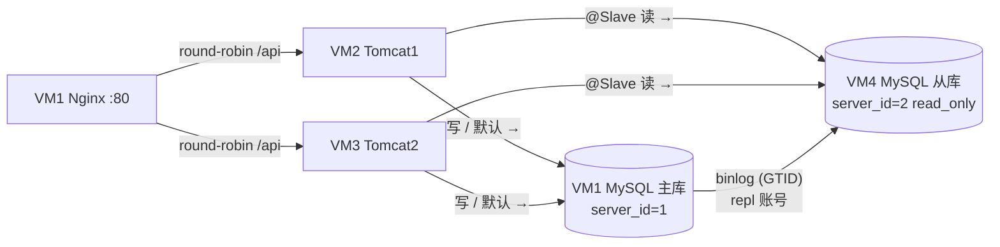

# MySQL 读写分离部署文档（主从复制 + Spring 数据源路由）

## 1. 文档目的与适用范围

本文对应课程要求：**后台数据库做读写分离**。在 [Tomcat集群部署文档.md](./Tomcat集群部署文档.md) 三虚拟机集群的基础上：

- 数据库层：MySQL 8 **GTID 异步主从复制**，主库（VM1）写、从库（VM4）读。
- 应用层：Spring Boot **双数据源 + 路由切面**，写与默认访问自动走主库，`@Slave` 标注的只读方法走从库。

前置条件：已按集群文档完成 VM1–VM3 的系统、网络、MySQL、Tomcat、Nginx 部署与 `ROOT.war` 发布，集群可正常访问。

新增节点：

| 节点 | IP | 组件 | 规格 | 说明 |
|------|----|------|------|------|
| VM4 | 192.168.56.104 | MySQL 8（从库） | 1 vCPU / 1 GB / 20 GB | 只读副本，`server-id=2`、`read_only=ON` |

> VM4 只跑 MySQL，1 GB 内存足够（`innodb_buffer_pool_size=512M`）。VirtualBox 建法与集群文档 4.1 相同：NAT + Host-Only 双网卡，静态 IP 见 4.2 风格，主机名建议 `vm4`。

---

## 2. 总体架构

### 2.1 拓扑



### 2.2 读写路由规则

| 访问类型 | 路由 | 说明 |
|----------|------|------|
| INSERT / UPDATE / DELETE | 主库 | 未标注的数据访问默认落主库，写安全优先 |
| 普通查询（未标注） | 主库 | 默认行为，避免误配造成数据不一致 |
| Service 方法标注 `@Slave` | 从库 | 仅限可容忍主从延迟的只读方法 |
| 事务中的访问 | 主库 | 由事务拦截器前的切面优先级保证，见 8.3 |

### 2.3 请求链路

1. 浏览器请求经 Nginx 轮询到某台 Tomcat。
2. 应用内切面判断：方法带 `@Slave` → 线程路由键置为 SLAVE；否则默认 MASTER。
3. `RoutingDataSource` 按路由键从主/从两个 HikariCP 连接池中取连接执行 SQL。
4. 主库上所有变更经 binlog 异步复制到从库；从库 `read_only=ON` 拒绝应用直写。

---

## 3. 主库（VM1）准备

### 3.1 确认 GTID 与 binlog 已开启

本版 `deploy/mysql/mysqld-campus.cnf` 已包含主库复制参数（`server-id=1`、`log-bin`、`binlog_format=ROW`、`gtid_mode=ON`）。若你按集群文档部署时用的还是旧版模板，重新分发并重启：

```bash
# 在 Windows 仓库根目录执行
scp deploy/mysql/mysqld-campus.cnf root@192.168.56.101:/tmp/

# 在 VM1 上执行
sudo cp /tmp/mysqld-campus.cnf /etc/mysql/mysql.conf.d/campus.cnf
sudo systemctl restart mysql
sudo mysql -e "SHOW VARIABLES WHERE Variable_name IN
  ('server_id','log_bin','binlog_format','gtid_mode','enforce_gtid_consistency');"
```

预期：`log_bin=ON`、`binlog_format=ROW`、`gtid_mode=ON`、`enforce_gtid_consistency=ON`。

> **顺序提醒**：GTID 必须在导入业务数据之前开启，binlog 才会完整覆盖已有数据。如果你的库是在开启 GTID 之前导入的，按 6.1 用 `mysqldump` 全量初始化从库即可覆盖该问题（dump 会携带 `GTID_PURGED`）。

### 3.2 创建复制账号

```bash
# 在 Windows 仓库根目录执行（先把 ChangeMe_Repl_123 替换为实际密码）
scp deploy/mysql/init-repl.sql root@192.168.56.101:/tmp/

# 在 VM1 上执行
sudo mysql < /tmp/init-repl.sql
sudo mysql -e "SHOW GRANTS FOR 'repl'@'192.168.56.%';"
```

说明：`repl` 账号只授予 `REPLICATION SLAVE` 最小权限；账号存于 `mysql` 系统库，不会随业务库复制到从库。

### 3.3 防火墙放行从库

复制方向是**从库连主库**，主库需放行 VM4 的 3306 访问（若启用了 ufw）：

```bash
# 在 VM1 上执行
sudo ufw allow from 192.168.56.104 to any port 3306 proto tcp
```

---

## 4. 从库（VM4）安装与配置

### 4.1 安装 MySQL 8

```bash
sudo apt update
sudo apt install -y mysql-server
```

### 4.2 部署从库配置

```bash
# 在 Windows 仓库根目录执行
scp deploy/mysql/mysqld-campus-slave.cnf root@192.168.56.104:/tmp/

# 在 VM4 上执行
sudo cp /tmp/mysqld-campus-slave.cnf /etc/mysql/mysql.conf.d/campus.cnf
sudo systemctl restart mysql
sudo systemctl enable mysql
sudo ss -lntp | grep 3306
sudo mysql -e "SHOW VARIABLES WHERE Variable_name IN
  ('server_id','gtid_mode','read_only','super_read_only');"
```

预期：监听 `192.168.56.104:3306`；`server_id=2`、`gtid_mode=ON`、`read_only=ON`。

防火墙放行应用节点访问（若启用了 ufw，规则风格与集群文档 4.4 一致）：

```bash
# 在 VM4 上执行
sudo ufw default deny incoming
sudo ufw default allow outgoing
sudo ufw allow 22/tcp
sudo ufw allow from 192.168.56.102 to any port 3306 proto tcp
sudo ufw allow from 192.168.56.103 to any port 3306 proto tcp
```

### 4.3 在从库补建应用账号

应用账号 `campus` 存于 `mysql` 系统库，**不随业务库复制**，必须在从库单独创建（密码与主库一致）：

```bash
sudo mysql <<'EOF'
CREATE USER IF NOT EXISTS 'campus'@'192.168.56.%' IDENTIFIED BY 'ChangeMe_123';
GRANT SELECT, INSERT, UPDATE, DELETE ON campus_repair.* TO 'campus'@'192.168.56.%';
FLUSH PRIVILEGES;
EOF
```

> 从库虽为 `read_only`，但 `CREATE USER` 由具备 `SYSTEM_VARIABLES_ADMIN`/`CREATE USER` 权限的 root 执行不受限制；从库恢复复制回放也不受影响。

---

## 5. 建立复制链路

### 5.1 主库导出全量数据

```bash
# 在 VM1 上执行
sudo mysqldump --single-transaction --source-data=2 \
  --routines --events --triggers campus_repair > /tmp/campus_repair.sql
# --source-data=2 会以注释形式写入 GTID_PURGED，从库据此对齐 GTID 起点
scp /tmp/campus_repair.sql root@192.168.56.104:/tmp/
```

### 5.2 从库导入并启动复制

```bash
# 在 VM4 上执行
sudo mysql -e "CREATE DATABASE IF NOT EXISTS campus_repair
  DEFAULT CHARACTER SET utf8mb4 COLLATE utf8mb4_0900_ai_ci;"
sudo mysql campus_repair < /tmp/campus_repair.sql

sudo mysql <<'EOF'
CHANGE REPLICATION SOURCE TO
  SOURCE_HOST       = '192.168.56.101',
  SOURCE_USER       = 'repl',
  SOURCE_PASSWORD   = 'ChangeMe_Repl_123',
  SOURCE_AUTO_POSITION = 1;
START REPLICA;
EOF
```

> `SOURCE_AUTO_POSITION=1` 是 GTID 复制的关键：从库自动按缺失的 GTID 补数据，不需要手工抄写 binlog 文件名和位点。

### 5.3 复制状态验证

```bash
sudo mysql -e "SHOW REPLICA STATUS\G" | grep -E
  "Replica_IO_Running|Replica_SQL_Running|Seconds_Behind_Source|Last_Error|Retrieved_Gtid_Set"
```

| 字段 | 预期 | 含义 |
|------|------|------|
| `Replica_IO_Running` | Yes | 拉 binlog 的线程正常 |
| `Replica_SQL_Running` | Yes | 回放 binlog 的线程正常 |
| `Seconds_Behind_Source` | 0 | 主从延迟（秒） |
| `Last_Error` | 空 | 无回放错误 |

### 5.4 写主读从验证

```bash
# 主库（VM1）写入
sudo mysql -e "CREATE DATABASE IF NOT EXISTS rw_check; USE rw_check;
  CREATE TABLE IF NOT EXISTS t(id INT PRIMARY KEY); INSERT INTO t VALUES(1);"

# 从库（VM4）读取
sudo mysql -e "SELECT * FROM rw_check.t;"   # 预期查到 id=1

# 清理（在主库执行，DROP 会随复制同步到从库）
sudo mysql -e "DROP DATABASE rw_check;"
```

若从库查不到，先回到 5.3 看两个线程是否为 Yes、`Last_Error` 是什么。

---

## 6. 应用侧实现（代码已入库）

### 6.1 新增类清单

| 类 | 位置 | 职责 |
|----|------|------|
| `DataSourceKey` | `datasource/` | 路由键枚举：MASTER / SLAVE |
| `DynamicDataSourceContextHolder` | `datasource/` | ThreadLocal 保存当前线程路由键，默认 MASTER |
| `RoutingDataSource` | `datasource/` | 继承 `AbstractRoutingDataSource`，按路由键选连接池 |
| `Slave` | `datasource/` | 标注只读 Service 方法，路由到从库 |
| `SlaveDataSourceAspect` | `datasource/` | `@Aspect` 切面：`@Slave` 方法执行前切从库，finally 清理 |
| `DataSourceRoutingConfig` | `config/` | 构建主/从两个 HikariCP 池并注册路由数据源（条件装配） |

### 6.2 路由流程

```text
Controller
   └─> Service 方法（@Slave?）
         ├─ 无标注 ──────────────> ThreadLocal = MASTER（默认）
         └─ @Slave ─ 切面设置 ──> ThreadLocal = SLAVE
               └─> RoutingDataSource.determineCurrentLookupKey()
                     ├─ MASTER ─> masterDataSource（VM1 :3306）
                     └─ SLAVE  ─> slaveDataSource （VM4 :3306）
```

### 6.3 为什么切面优先级必须最高

JPA 在**事务开启时**就申请数据库连接。若切面晚于 `@Transactional` 执行，事务已经拿着主库连接，从库路由不会生效。因此 `SlaveDataSourceAspect` 标注 `@Order(Ordered.HIGHEST_PRECEDENCE)`，保证路由键先于事务拦截器设置。同理，`@Slave` 只能标注在 **Service 层公开方法**上（内部 `this` 调用不走代理，切面不生效）。

### 6.4 配置项

`application-prod.properties`（密码经环境变量注入，不入库）：

```properties
# 读写分离开关；未开启时沿用 spring.datasource.* 单数据源，本地开发不受影响
app.datasource.routing-enabled=true

spring.datasource.master.jdbc-url=jdbc:mysql://${DB_HOST:192.168.56.101}:${DB_PORT:3306}/campus_repair?...
spring.datasource.master.username=${DB_USERNAME:campus}
spring.datasource.master.password=${DB_PASSWORD:ChangeMe_123}
spring.datasource.master.maximum-pool-size=10

# 从库；jdbc-url 留空则读操作自动回落主库（应用可先于从库上线）
spring.datasource.slave.jdbc-url=jdbc:mysql://${DB_SLAVE_HOST:192.168.56.104}:${DB_PORT:3306}/campus_repair?...
spring.datasource.slave.username=${DB_USERNAME:campus}
spring.datasource.slave.password=${DB_PASSWORD:ChangeMe_123}
spring.datasource.slave.maximum-pool-size=10
```

`setenv.sh`（VM2 / VM3 各一份）新增：

```bash
export DB_SLAVE_HOST=192.168.56.104
```

> 绑定 `HikariDataSource` 时属性名是 `jdbc-url` 而不是 `url`，这是 Hikari 的 setter 命名（`setJdbcUrl`），写成 `url` 不会报错但连接池拿不到地址。

### 6.5 使用规范

1. `@Slave` 只加在**只读**的 Service 方法上，加了写操作会因从库 `read_only=ON` 直接报错（1290），这正是安全网。
2. **写后立读不要用**：如"提交工单后立即查列表"，主从延迟内可能看不到刚写的数据。业务示例中仅对工单状态列表（`findByStatus`，管理端批量查询场景）做了演示性路由。
3. 事务内不要再切库，事务全程使用一个连接。

---

## 7. 构建与发布

代码变更后需重新打包 WAR 并发布到两台 Tomcat：

```bash
# 在 Windows 仓库根目录执行（构建步骤见集群文档 9.1）
mvn -f backend/pom.xml clean package -DskipTests
scp backend/target/ROOT.war root@192.168.56.102:/tmp/
scp backend/target/ROOT.war root@192.168.56.103:/tmp/

# 在 VM2 / VM3 上执行（发布与重启见集群文档 9.2）
sudo cp /tmp/ROOT.war /opt/tomcat/webapps/ROOT.war
sudo systemctl restart tomcat
```

确认启动日志出现 `The following 1 profile is active: "prod"`。

---

## 8. 验证矩阵

在 Windows（或教师机）逐项执行：

| # | 操作 | 预期 | 
|---|------|------|
| 1 | `curl http://192.168.56.101/api/system/db` | `routingEnabled=true`；`master.readOnly=false`、`slave.readOnly=true`；两者 `serverId` 分别为 1、2，`hostname` 不同 |
| 2 | 连续执行 10 次上述命令 | 每次 master/slave 结果稳定（路由按方法而非轮询） |
| 3 | `curl http://192.168.56.101/api/orders/status/SUBMITTED` | 正常返回列表（该接口标注 `@Slave`，走从库） |
| 4 | `curl -X POST http://192.168.56.101/api/orders ...` 创建工单后查从库 | 写入落主库，稍后（≤1 秒）出现在从库 |
| 5 | VM4 上 `SHOW REPLICA STATUS\G` | 两线程 Yes，`Seconds_Behind_Source` 为 0 |
| 6 | 多次访问 `/api/system/db` 同时观察 5 | 延迟保持 0 附近 |

预期响应示例（字段节选）：

```json
{
  "routingEnabled": true,
  "master": { "hostname": "vm1", "serverId": 1, "readOnly": false, "version": "8.0.x" },
  "slave":  { "hostname": "vm4", "serverId": 2, "readOnly": true,  "version": "8.0.x" }
}
```

### 8.1 故障演练与回退

| 场景 | 操作 | 现象与处置 |
|------|------|------------|
| 从库宕机 | VM4 关机后访问 `/api/orders/status/...` | `@Slave` 读报连接异常——演示"读写分离的可用性代价" |
| 紧急回退单库 | 两台 Tomcat 的 `setenv.sh` 中 `export DB_SLAVE_HOST=` 置空并重启 Tomcat | 读操作自动回落主库（配置见 6.4） |
| 完全关闭路由 | `application-prod.properties` 中 `routing-enabled=false` 重新发布 | 回到单数据源模式 |
| 从库恢复 | VM4 开机，`SHOW REPLICA STATUS` 确认两线程 Yes | 恢复 `DB_SLAVE_HOST` 与重启即可 |

### 8.2 建议截图清单

1. `SHOW VARIABLES` 主库 GTID/binlog 参数（3.1）。
2. `SHOW REPLICA STATUS\G` 复制状态（5.3）。
3. 写主读从验证（5.4）。
4. `/api/system/db` 响应，体现 master/slave 差异（8-1）。
5. 从库宕机时的读失败与回退后恢复（8.1）。

---

## 9. 常见问题

| 现象 | 原因与处置 |
|------|------------|
| `Replica_IO_Running: No`，`Last_Errno: 1045` | `repl` 密码不一致或授权网段不对，回 3.2 核对 |
| `Replica_IO_Running: No`，`Last_Errno: 1236` | GTID 起点冲突：从库曾复制过其它主库，`RESET REPLICA ALL;` 后重做第 5 章 |
| `Last_Errno: 1062` 回放报重复 | 从库有主库没有的手工数据，清掉从库多余数据后 `START REPLICA;` |
| `Seconds_Behind_Source` 为 NULL | 复制线程未运行，看两个 Running 与 `Last_Error` |
| 应用读请求报 `1290: The MySQL server is running with the super_read_only` | `@Slave` 方法里混入了写操作，改为默认主库路由或拆方法 |
| 启动正常但 slave 结果与 master 相同 | 从库 `jdbc-url` 配成主库地址；或 `DB_SLAVE_HOST` 环境变量没生效，`echo $DB_SLAVE_HOST` 核对 |
| 应用连不上从库账号 | 从库未执行 4.3 的 `CREATE USER`（用户表不随业务库复制） |
