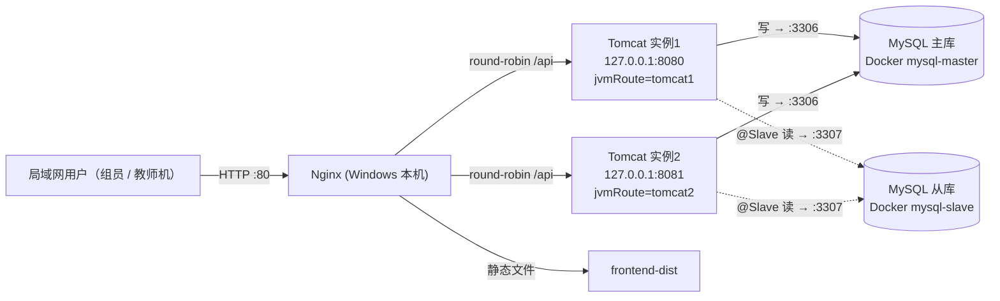

# Tomcat 集群部署文档（本机双实例 + Nginx，生产形态）

## 1. 文档目的与适用范围

本文对应课程要求：**学会 Tomcat 应用服务器配置、掌握基本参数，完成 Tomcat 集群并接入 Nginx**。

与早期版本的本质区别：早期方案是“为了演示搭 3 台虚拟机”；本方案把集群定位为**项目的真实运行方式（项目服务器）**——项目迭代后经滚动更新发布上线，组员与教师在局域网内直接访问使用。演示只是这套真实运行方式的一部分能力（故障转移）的自然体现。

要点一览：

- **零虚拟机**：应用层与数据库层全部运行在 Windows 本机，安装配置一次即可长期运行。
- **一份 Tomcat 安装 + 两个实例目录**：标准 `CATALINA_HOME / CATALINA_BASE` 分离，“两个端口”（8080 / 8081）跑双实例。
- **数据库沿用读写分离方案**：两实例都连 Docker 主从（主 3306 写、从 3307 读），与 [MySQL读写分离部署文档](./MySQL读写分离部署文档.md) 完全兼容，互不影响。
- **JWT 无状态认证**：任意节点可独立校验 token，无需会话复制、无需 `ip_hash`。
- **团队可复现**：全部模板与脚本随 git 仓库分发，组员拉取后一键安装（见第 11 章）。

---

## 2. 总体架构

### 2.1 拓扑



### 2.2 端口规划（同机多实例必须全端口错开）

| 端口 | 归属 | 绑定地址 | 说明 |
|------|------|----------|------|
| 80 | Nginx | `0.0.0.0` | 项目统一入口，对局域网开放 |
| 8080 | 实例 1 HTTP Connector | `127.0.0.1` | 仅服务本机 Nginx |
| 8081 | 实例 2 HTTP Connector | `127.0.0.1` | 仅服务本机 Nginx |
| 8005 | 实例 1 Shutdown | `127.0.0.1` | 关闭命令端口 |
| 8006 | 实例 2 Shutdown | `127.0.0.1` | 与实例 1 错开 |
| 3306 / 3307 | Docker MySQL 主/从 | 宿主映射 | 见读写分离文档 |

> 外部 Tomcat 部署时，应用内 `server.port` 与 `server.servlet.context-path` **不生效**：
> 端口由 `server.xml` Connector 决定，上下文由 WAR 文件名决定（本项目部署为 `ROOT.war`）。这是最容易踩的误区。

### 2.3 请求链路

1. 用户访问 `http://<项目服务器IP>/`，Nginx 返回前端静态文件（SPA）。
2. 前端请求 `/api/...`，Nginx 按轮询转发至实例 1 或实例 2。
3. Tomcat 中的 Spring Boot（prod profile）写请求走主库，`@Slave` 只读请求走从库。
4. 每个响应可从 Nginx 访问日志看到 `upstream=` 命中节点与耗时；将节点诊断能力收敛在 `/api/system/node`（第 10 章）。

---

## 3. 目录与实例规划

一份 Tomcat 安装（`CATALINA_HOME`，共享 `bin/`、`lib/`），两个实例目录（各自 `CATALINA_BASE`）：

```text
D:\campus\                        ← CampusRoot（可自定义）
  apache-tomcat-11.0.x\           ← CATALINA_HOME：bin、lib 共享，不改动
  instance1\                      ← CATALINA_BASE ①
    bin\setenv.bat                ← JVM 参数 + Spring 环境变量（8080 节点）
    conf\server.xml               ← server-node1.xml 的产物
    webapps\ROOT.war              ← 构建产物副本
    logs\  temp\  work\
  instance2\                      ← CATALINA_BASE ②（8081 节点，结构同上）
  uploads\                        ← 两实例共享的上传目录（同机天然共享磁盘）
  lib\                            ← JDK 25 安装位置提示（实际以 JAVA_HOME 为准）
```

为何不用“复制两份 Tomcat”：共享 `bin/lib` 只需升级一个安装包，且两个实例的容器级配置差异收敛在 `conf/`、`bin/setenv.bat`，避免了双份安装出现“改了这个忘了那个”的漂移。

为何两实例都部署 `ROOT.war`：上下文为空，`/api/**` 原始路径不变，Nginx 无需重写 URI。

---

## 4. 一次性准备

### 4.1 JDK 25

1. 安装 Temurin JDK 25（`https://adoptium.net`）。
2. 设置系统环境变量 `JAVA_HOME` 指向安装目录（`setup-cluster.ps1` 依赖它，也会把它写进每个实例的 `setenv.bat`）。
3. 构建端与运行端必须同为 JDK 25，否则容器报 `UnsupportedClassVersionError`。

### 4.2 Tomcat 11

1. 下载 Tomcat **11.0.x** 压缩包（必须 11：Tomcat 10.1 是 Servlet 6.0、Tomcat 9 是 `javax.*`，与 Spring Boot 4 不兼容）。
2. 解压到 `<CampusRoot>\apache-tomcat-11.0.x`（如 `D:\campus\apache-tomcat-11.0.16`）。
3. **不要解压多份**——双实例共用这一个安装目录即可。

### 4.3 代码构建

```text
# 后端：mvn package才会生成可执行 WAR 的 lib-provided 目录
cd backend
.\mvnw.cmd clean package -DskipTests     → backend\target\ROOT.war

# 前端
cd frontend
npm ci || npm install
npm run build                            → frontend\dist\
```

### 4.4 端口占用检查（一次性）

在本机以管理员 PowerShell 执行：

```powershell
Get-NetTCPConnection -State Listen |
  Where-Object { $_.LocalPort -in 80,8005,8006,8080,8081 } |
  Select-Object LocalAddress,LocalPort,OwningProcess
```

80 被 IIS / XAMPP 占用时先停掉对应服务（`net stop was /y` 或关闭 XAMPP 的 Apache）；
8080 通常是被开发模式的 `java -jar` 占用，**制起集群时必须先停掉它**（第 14 章）。

---

## 5. 一键安装（setup-cluster.ps1）

```powershell
git pull                      # 保持 deploy\cluster 为最新
cd deploy\cluster
powershell -ExecutionPolicy Bypass -File .\setup-cluster.ps1
# 或自定义路径：
powershell -ExecutionPolicy Bypass -File .\setup-cluster.ps1 -CampusRoot "D:\campus" -CatalinaHome "D:\campus\apache-tomcat-11.0.16"
```

脚本做的事（全部幂等，可重复执行）：

| 步骤 | 内容 |
|------|------|
| 1 | 校验 Tomcat 11（找 `bin\catalina.bat`）与 JDK 25（优先 `JAVA_HOME`） |
| 2 | 生成 `instance1\`、`instance2\` 的 `bin/conf/logs/temp/webapps/work` 目录 |
| 3 | 写入 `conf\server.xml`（分别用 `server-node1.xml` / `server-node2.xml`） |
| 4 | 从 CATALINA_HOME 复制 `web.xml`、`context.xml`、`catalina.properties` 等基础配置到两实例 |
| 5 | 以 `setenv.template.bat` 生成本实例的 `bin\setenv.bat`，替换 `__JAVA_HOME__` 占位符 |
| 6 | 若存在 `backend\target\ROOT.war`，复制到两实例 `webapps\` |
| 7 | 生成共享 `uploads\` 目录 |
| 8 | 生成本机路径配置 `cluster.local.bat`（含个人路径，**不入库**） |

安装后必须手工做两件事：

1. 编辑两个实例的 `bin\setenv.bat`，把 `DB_PASSWORD=ChangeMe_123` 替换为真实密码（与 Docker 容器应用账号一致）；改 `UPLOAD_DIR`、`CORS_ALLOWED_ORIGINS` 时以实际为准。
2. 首次部署 `ROOT.war`：构建后复制到两实例 `webapps\`（见第 8 章发布流程）。

---

## 6. Tomcat 基本参数详解

### 6.1 `server.xml` Connector 参数（模板已内置，逐个理解）

| 参数 | Tomcat 11 默认 | 本方案取值 | 含义与说明 |
|------|----------------|-----------|------------|
| `Server port` | 8005 | 实例1 `127.0.0.1:8005` / 实例2 `127.0.0.1:8006` | 关闭命令端口，只允许本机连接 |
| `Server shutdown` | `SHUTDOWN` | `SHUTDOWN` | 如需强化，可改成随机强字符串 |
| `Connector port` | 8080 | **8080 / 8081** | HTTP 端口；应用内 `server.port` 无效 |
| `address` | 全部接口 | `127.0.0.1` | 实例不直接对外暴露，仅本机 Nginx 可达 |
| `protocol` | 自动选 | `Http11NioProtocol` | NIO 非阻塞连接器 |
| `connectionTimeout` | 20000 | 20000 | 等待请求行的毫秒数 |
| `keepAliveTimeout` | =connectionTimeout | 20000 | 长连接空闲超时 |
| `maxKeepAliveRequests` | 100 | 200 | 单连接最大请求数 |
| `maxThreads` | 200 | **100** | 最大工作线程。2 实例合计 200，详见第 12 章容量依据 |
| `minSpareThreads` | 10 | 20 | 常驻热线程，降低突发延迟 |
| `maxConnections` | 8192 | 8192 | NIO 最大连接数 |
| `acceptCount` | 100 | 100 | 连接队列长度 |
| `URIEncoding` | UTF-8 | UTF-8（显式写出） | URI 解码字符集 |
| `maxHttpHeaderSize` | 8192 | 8192 | 请求/响应头上限 |
| `maxPostSize` | 2 MiB | 52428800 | form/multipart 参数上限，对齐上传 50MB |
| `maxSwallowSize` | 2 MiB | 52428800 | 上传中止时吞掉的 body 上限 |
| `compression` | off | on | gzip 压缩（Nginx 已开时可关） |
| `server` | 有版本串 | `CampusRepair-Tomcat` | 隐藏真实版本号 |
| `Engine jvmRoute` | 无 | `tomcat1` / `tomcat2` | 节点标识 |
| `Host autoDeploy` | true | **false** | 生产形态：发布走“停改启”，避免读到半个 WAR |
| `Host unpackWARs` / `deployOnStartup` | true / true | true / true | 启动时解压并部署 |
| AJP Connector | 未启用 | 保持禁用 | 只走 Nginx HTTP |
| AccessLogValve | common | 含 `%D`、X-Forwarded-For | 记录毫秒耗时与真实客户端 IP |
| ErrorReportValve | — | showReport/showServerInfo=false | 错误页不泄露栈与版本 |

### 6.2 JVM 参数（`setenv.bat`，每实例相同）

| 参数 | 取值 | 说明 |
|------|------|------|
| `-Xms / -Xmx` | 512m / 1024m | 堆固定，避免抖动；双实例合计约 2GB 峰值 |
| `-XX:MetaspaceSize / MaxMetaspaceSize` | 128m / 256m | Spring + Tomcat 类元数据 |
| `-XX:+UseG1GC -XX:MaxGCPauseMillis=200` | 启用 | 低延迟 GC |
| `-Dfile.encoding` | UTF-8 | 避免中文日志乱码 |
| `-Duser.timezone` | Asia/Shanghai | 与 MySQL 时区一致 |
| `-Djava.security.egd` | `file:/dev/./urandom` | 加快启动随机数初始化 |
| `JRE_HOME / JAVA_HOME` | setup 脚本写入真实路径 | 指向 JDK 25 |

> Windows 下是 `setenv.bat`（CRLF 原生批处理，仓库已用 `.gitattributes` 固定换行），不再是 Linux 的 `setenv.sh`。

---

## 7. Nginx 配置详解（`cluster/nginx/nginx.conf`）

覆盖 Nginx Windows 版的 `conf\nginx.conf`（完整文件已在模板中，含 http 全局块），关键逻辑如下：

```nginx
upstream campus_backend {
    server 127.0.0.1:8080 max_fails=3 fail_timeout=30s;
    server 127.0.0.1:8081 max_fails=3 fail_timeout=30s;
    keepalive 32;
}
```

- 不写 `least_conn` / `ip_hash`，默认**轮询**；JWT 无状态不需要粘滞。
- `max_fails=3 fail_timeout=30s` 是**被动健康检查**：连续 3 次失败，该节点暂停 30 秒（这就是滚动更新期间“背走负载”的机制）。
- `proxy_next_upstream error timeout http_502 http_503 http_504`：幂等请求遇到故障自动切到另一实例。**不加 `non_idempotent`**：工单创建无幂等校验前，盲目重试 POST 会重复建单。
- `location ^~ /api/` 的 `proxy_pass` 末尾不带 URI：`/api/...` 原样转发。
- `client_max_body_size 50m`：必须 ≥ Spring 的 50MB multipart 上限，否则大文件先在 Nginx 层 413。
- `root "D:/campus/frontend-dist"`：指向前端构建产物目录（发布 `npm run build` 后替换内容，无需 reload）。
- `try_files $uri $uri/ /index.html`：支持 Vue Router history 模式。
- 访问日志记录 `upstream=$upstream_addr rt=... urt=...`：观察负载分布与慢请求的第一入口。

常用命令（Nginx 安装目录）：

```text
nginx.exe -t             配置校验
start nginx.exe          启动
nginx.exe -s reload      配置变更后重载
nginx.exe -s quit        优雅退出
```

---

## 8. 发布流程（滚动更新 · 日常使用核心）

项目每次迭代发布的标准流程。核心思想：**一个节点停机发布，另一个节点独立承接全程流量**，配合 Nginx 被动健康检查实现“用户无感知”。

### 8.1 构建

```text
cd backend && .\mvnw.cmd clean package -DskipTests → target\ROOT.war
cd frontend && npm run build                       → dist\
```

### 8.2 依次滚动（实例1 → 实例2）

```text
# 第一轮
1. 双击 stop-tomcat1.bat                    → Nginx 自动把流量全给实例2
2. 复制 target\ROOT.war → instance1\webapps\（覆盖）
   清理 instance1\logs 下的历史解压目录 ROOT\（Tomcat 会在启动时重新解压）
3. 双击 start-tomcat1.bat
4. 打开 instance1\logs\catalina.out 确认部署完成、prod profile 生效
   （或 curl http://127.0.0.1:8080/api/system/node）

# 第二轮（实例1 已稳定，开始动实例2）
5. stop-tomcat2.bat → 换 WAR → start-tomcat2.bat → 同样确认
```

两轮之间的关键顺序：**先验证节点恢复健康，再停下一节点**。全程任何时刻至少一个节点在线。

### 8.3 前端发布

`npm run build` 后，把 `frontend\dist\` 的**内容**（保证 `index.html` 位于 root 目录第一层）覆盖到 Nginx root 目录，静态替换无需 reload；改了 nginx.conf 才执行 `nginx.exe -t && nginx.exe -s reload`。

### 8.4 数据库 schema 变更（发布日的特殊步骤）

生产使用 `ddl-auto=validate`，实体改动导致表结构需要变更时，发布前先在主库手工执行迁移 SQL（从库随复制同步），**确认 `SHOW REPLICA STATUS` 两线程为 Yes 后再发布应用**，避免双实例同时启动校验失败。

---

## 9. 项目服务器与局域网访问

集群跑在一台组员的电脑上作为项目服务器时：

1. `ipconfig` 查看本机局域网 IPv4（如 `192.168.1.23`）。
2. Nginx 已绑 `0.0.0.0:80`，其它组员/教师直接访问 `http://192.168.1.23/`。
3. Windows 防火墙放行 80 入站（放行时确认来源只选“专用网络”，避免暴露到公共 Wi-Fi）：
   ```powershell
   New-NetFirewallRule -DisplayName "campus-repair-nginx" -Direction Inbound `
     -Protocol TCP -LocalPort 80 -Action Allow -Profile Private
   ```
4. `setenv.bat` 的 `CORS_ALLOWED_ORIGINS` 补充 `http://192.168.1.23`（经 Nginx 同源访问时 CORS 本不触发，该值仅覆盖直连调试场景）。

> 服务器机器需保持开机与 Docker Desktop 运行状态；白天合组使用的时段注意电源策略不要休眠。

---

## 10. 运维与健康检查接口（`/api/system`）

两个端点定位为**运维工具**：发布验证、排障时主动使用，不是给浏览器访问的业务接口。

| 端点 | 返回内容 | 运维用途 |
|------|----------|----------|
| `GET /api/system/node` | `{hostname, localPort, time}` | 确认请求被哪个实例处理；发布后验证节点已在承接流量（localPort 应在 8080/8081 之间变化） |
| `GET /api/system/db` | `{routingEnabled, master{serverId,readOnly...}, slave{...}}` | 验证两实例的数据源路由正确：master `readOnly=0`、slave `readOnly=1`，serverId 分别为 1/2 |

```powershell
# 发布后的健康确认（curl 或浏览器）
curl http://127.0.0.1:8080/api/system/node
curl http://127.0.0.1:8081/api/system/node
curl http://localhost/api/system/db          # 经 Nginx，命中任一实例都应返回两端信息
```

---

## 11. 组员十分钟上手

前提：Windows、已装 Docker Desktop、能 git pull。

```text
1. git clone（或 pull）仓库，拉到最新
2. cd deploy\docker && docker compose up -d          # MySQL 主从（读写分离文档第 3~4 章首次需建复制）
3. 安装 JDK 25 并设置 JAVA_HOME；Tomcat 11 zip 解压到 D:\campus\apache-tomcat-11.0.x
4. cd deploy\cluster
   powershell -ExecutionPolicy Bypass -File .\setup-cluster.ps1
5. 改两实例 bin\setenv.bat 里的 DB_PASSWORD 为真实密码
6. backend: .\mvnw.cmd clean package -DskipTests → 复制 target\ROOT.war 到两实例\webapps\
7. frontend: npm run build → 把 dist\ 内容放到 Nginx root（改 nginx.conf 里的 root 为本机路径）
8. 启动：start-tomcat1.bat、start-tomcat2.bat、nginx.exe
9. 打开 http://localhost/api/system/node —— 多刷几次，localPort 在 8080/8081 交替即成功
```

协作铁律：`deploy\cluster\` 下的模板与脚本人人同名同内容；只有两个东西留在本地不提交——
`cluster.local.bat`（本机路径）与实例目录（setup 产物）。改了模板才提交 git，组员 pull 后重跑 setup 即同步。

---

## 12. 容量与参数依据

| 项 | 取值 | 依据 |
|----|------|------|
| 实例堆 | 512m ~ 1024m × 2 | 校园师生级并发（数十至数百人）；单实例实际常驻内存 ~600MB 量级 |
| `maxThreads` | 100 × 2 | Tomcat 默认 200 对 2 实例是过度配置；100 足够且减少线程栈开销（每实例线程栈≈100×1MB） |
| Hikari 连接池 | 每实例主/从各 10 | 合计 40 连接，MySQL `max_connections=200` 余量充足 |
| Nginx `worker_processes auto` | CPU 核数 | Windows 版性能短板在本项目流量下不可及 |
| 上传链路 | Nginx 50m = Spring 50MB | 两端一致，避免 413 边界不明确 |
| 数据库 | Docker 主从各 `max_connections=200` | 与读写分离文档约定一致 |

---

## 13. 上线检查清单（每次发布后）

- [ ] 两个 `start` 脚本启动的实例进程在位（任务管理器两个 `java.exe`，或 `Get-NetTCPConnection -LocalPort 8080,8081 -State Listen` 两条）
- [ ] `curl http://127.0.0.1:8080/api/system/node` 与 `:8081` 均 200
- [ ] 经 Nginx `curl http://localhost/api/orders/status/PENDING` 返回 200
- [ ] 连刷 `http://localhost/`，浏览器 F12 → Network 无异常；`/api/system/db` 返回 master/slave 的 `serverId=1/2`、`readOnly=0/1`
- [ ] `instanceN\logs\catalina.out` 最新日志无 ERROR / Schema 校验失败
- [ ] 发布前的 schema 迁移已在主库执行且复制延迟 `Seconds_Behind_Source=0`
- [ ] Nginx `nginx.exe -t` 通过；改配置后已 `-s reload`
- [ ] 大文件上传（例如 40MB 图片）路径正常；55MB 请求应被 Nginx 413 拦截
- [ ] 局域网组员能访问 `http://<服务器IP>/`（防火墙规则第一台机器一次性配置）

---

## 14. 与开发模式的关系（冲突清单）

全组采用两种运行模式，共享同一个仓库与代码：

| 模式 | 何时用 | 形态 | 端口 |
|------|--------|------|------|
| ① 单实例开发 | 日常 80% 时间，改代码-调试-自测 | `java -jar ROOT.war` 或 IDE / `mvnw spring-boot:run` | 8080 |
| ② 集群运行 | 发布、验收、联调、故障转移演练 | 本文档的双实例 + Nginx | 8081 |

**唯一冲突点**：模式① 默认占用 8080，与模式② 实例 1 相同。切换时先停止模式① 进程
（IDE 的 Stop 按钮、或 `jps -l | findstr campus` 后 `taskkill /PID <pid> /F`），再跑集群脚本。
该约定写进了《MySQL读写分离部署文档》第 10 章，全组严格遵守。

---

## 15. 故障排查

| 现象 | 原因 | 处理 |
|------|------|------|
| `start-tomcat*.bat` 报 `CATALINA_BASE 未设置` / 路径不对 | `cluster.local.bat` 缺失或路径错 | 重跑 setup-cluster.ps1 或手改该文件 |
| 实例启动报 `Address already in use: 8080` | 模式① 的 `java -jar` 占用 8080 | 按第 14 章停掉开发进程 |
| 启动报 `UnsupportedClassVersionError` | 构建端与运行端 JDK 不一致 | 两端统一 JDK 25，核对 setenv.bat 的 `JAVA_HOME` |
| 404（部署后 `/api/...`） | 旧解压目录未清 / WAR 名不是 ROOT | 清 `webapps\ROOT` 目录与 `work\`，确认 WAR 名为 ROOT.war |
| `catalina.out` 无 `profile is active: "prod"` | setenv.bat 未生效 | 确认它在 `<实例>\bin\`，文件为 CRLF、无语法错 |
| 应用连不上 MySQL | 容器未起 / 端口不存在 / 密码错 | `docker compose ps`、`docker exec mysql-master mysql -u campus -p ...` 验证 |
| 启动报 Schema 校验失败 | 实体与 `init.sql` 迁移不同步 | 见 8.4：先迁移数据库再发布；临时排查用 `ddl-auto=none` |
| Nginx 502 | 实例未启动 / 端口不通 | `curl http://127.0.0.1:8080/api/system/node` 直测两实例 |
| Nginx 413 | `client_max_body_size` 太小 | 提到 50m 与 Spring 一致 |
| 轮询总命中同一实例 | 客户端 keepalive 复用同一连接 | 多次新开请求或看 Nginx 日志 `upstream=` 分布 |
| 停实例后请求失败 | Nginx 被动检查正把流量切往另一节点 | 首次失败后自动恢复；检查另一个实例是否健康 |
| `*.bat` 在其它系统上改坏了 | 换行混入 LF | `.gitattributes` 已固定 crlf；执行 `git add --renormalize .` |
| 双实例数据不一致（理论上不发生） | 数据库读到了从库延迟 | 读接口标注 `@Slave` 且容忍延迟；写后立读场景只用主库 |

---

## 16. 附录：配置模板索引

| 模板 | 目标位置 | 说明 |
|------|----------|------|
| `deploy/cluster/conf/server-node1.xml` | `<实例1>\conf\server.xml` | 8080 / 8005 / tomcat1，参数全表见 6.1 |
| `deploy/cluster/conf/server-node2.xml` | `<实例2>\conf\server.xml` | 8081 / 8006 / tomcat2 |
| `deploy/cluster/conf/setenv.template.bat` | `<实例N>\bin\setenv.bat` | JVM + Spring 环境变量（setup 自动替换 JAVA_HOME） |
| `deploy/cluster/nginx/nginx.conf` | `<Nginx>\conf\nginx.conf` | 轮询 upstream + 静态站点，见第 7 章 |
| `deploy/cluster/setup-cluster.ps1` | 本目录执行 | 一键生成实例目录与本机配置 |
| `deploy/cluster/start|stop-tomcat1|2.bat` | 双击执行 | 实例独立启停，支撑滚动更新 |
| 应用属性 | `backend\src\main\resources\application-prod.properties` | `ddl-auto=validate`、双数据源、上传/CORS/转发头 |
