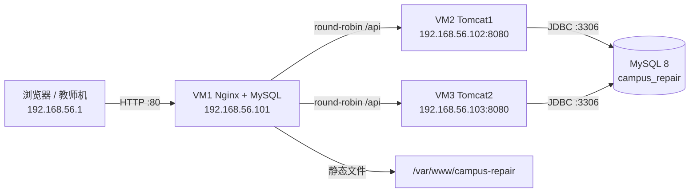

# Tomcat 集群部署文档（Nginx + 双 Tomcat 11 + MySQL）

## 1. 文档目的与适用范围

本文对应课程要求：**学会 Tomcat 应用服务器配置、掌握基本参数、构建虚拟机环境、完成 Tomcat 集群并接入 Nginx**。

部署形态：

- 后端由 Spring Boot 可执行 JAR 改造为 **WAR**，部署到两台独立安装的 **Tomcat 11**。
- 前端构建为静态文件，由 **Nginx** 托管；`/api/**` 由 Nginx 反向代理到两台 Tomcat，默认轮询。
- 数据库使用 **MySQL 8**，两台 Tomcat 共享同一个库。
- 登录态按项目规划采用 **JWT 无状态**，因此不需要 Tomcat 会话复制，也不需要 `ip_hash`。

与现有方案的关系：

| 方案 | 适用场景 | 后端运行方式 |
|------|----------|--------------|
| 本地开发 | 日常编码 | `mvn spring-boot:run` |
| Docker Compose | 单机快速演示 | 可执行 WAR，`java -jar app.war` |
| 本文三 VM 集群 | 课程部署考核 | 外部 Tomcat 11，部署 `ROOT.war` |

三种方案共用同一套代码和 `docs/sql/init.sql`，可以并存；但不要让 Docker Compose 与集群同时连接同一个数据库（前者使用 `ddl-auto=update`）。

---

## 2. 总体架构

### 2.1 拓扑



```text
[Windows 宿主 192.168.56.1]
            |
            | 80
            v
+-----------------------------+
| VM1 192.168.56.101          |
|  Nginx :80  +  MySQL :3306  |
+-----------------------------+
       |                 |
       | 8080            | 8080
       v                 v
+----------------+  +----------------+
| VM2 .102       |  | VM3 .103       |
| Tomcat1 :8080  |  | Tomcat2 :8080  |
+----------------+  +----------------+
```

### 2.2 节点与端口

| 节点 | IP | 组件 | 开放端口 | 说明 |
|------|----|------|----------|------|
| VM1 | 192.168.56.101 | Nginx 1.24、MySQL 8 | 22、80；3306 仅允许 .102/.103 | 统一入口 + 数据库 |
| VM2 | 192.168.56.102 | Tomcat 11 | 22、8080（仅 192.168.56.0/24） | `jvmRoute=tomcat1` |
| VM3 | 192.168.56.103 | Tomcat 11 | 22、8080（同上） | `jvmRoute=tomcat2` |

### 2.3 请求链路

1. 浏览器访问 `http://192.168.56.101/`，Nginx 返回前端静态文件。
2. 前端请求 `/api/...`，Nginx 按轮询转发到 `.102:8080` 或 `.103:8080`。
3. Tomcat 中的 Spring Boot 应用通过 JDBC 访问 VM1 的 MySQL。
4. 响应经 Nginx 返回浏览器；响应头 `X-Upstream` 可看到实际命中的节点。

---

## 3. 版本与资源规划

| 软件 | 版本 | 说明 |
|------|------|------|
| 操作系统 | Ubuntu Server 24.04 LTS | 三台一致 |
| JDK | Temurin 25 | 构建端与运行端必须一致 |
| Tomcat | 11.0.x（≥ 11.0.14） | 必须是 11，对应 Servlet 6.1 |
| MySQL | 8.0 / 8.4 | VM1 |
| Nginx | 1.24.x | Ubuntu 24.04 仓库版本 |
| Maven | 3.9.16 | Windows 构建端 |
| Node.js | 23.11.0 | 前端构建 |
| Spring Boot | 4.0.0 | 内嵌 Tomcat 11.0.14 |

资源建议：

| 对象 | vCPU | 内存 | 磁盘 |
|------|------|------|------|
| Windows 宿主 | ≥ 8 核 | ≥ 12 GB（推荐 16 GB） | 100 GB 空闲 |
| VM1 | 2 | 2–3 GB | 20 GB |
| VM2 | 2 | 2–3 GB | 20 GB |
| VM3 | 2 | 2–3 GB | 20 GB |

> 三台 VM 合计约 6 vCPU / 6–9 GB。若宿主内存只有 8 GB，可把每台降到 1.5 GB、Tomcat 堆降到 512m，但演示时会比较吃力。

---

## 4. 虚拟机与网络准备

### 4.1 创建虚拟机

以 VMware Workstation 为例（VirtualBox 同理）：

1. 下载 Ubuntu Server 24.04 LTS ISO。
2. 每台新建虚拟机：2 vCPU、2 GB 内存、20 GB 磁盘、2 个网卡。
3. 网卡 1：**NAT**，用于 `apt` 联网。
4. 网卡 2：**Host-Only**（VMware `VMnet1` / VirtualBox `vboxnet0`），网段 `192.168.56.0/24`。
5. 安装系统时创建普通用户，勾选 **OpenSSH Server**，不安装桌面环境。

> **Windows 与 Hyper-V 冲突**：VirtualBox 报 `VERR_NEM_*` / `VERR_SUPDRV_*` 时，优先改用 VMware Workstation 17+；或在管理员 PowerShell 执行 `bcdedit /set hypervisorlaunchtype off` 后重启（会影响 WSL2 / Docker Desktop）。

### 4.2 静态 IP

确认网卡名：

```bash
ip -br link
```

Ubuntu 24.04 使用 netplan。以 VM2 为例，创建 `/etc/netplan/01-campus.yaml`：

```yaml
network:
  version: 2
  renderer: networkd
  ethernets:
    ens33:                    # NAT：保留 DHCP，提供默认路由和 DNS
      dhcp4: true
    ens37:                    # Host-Only：静态地址，不配默认路由
      dhcp4: false
      addresses: [192.168.56.102/24]
```

VM1 改为 `192.168.56.101`，VM3 改为 `192.168.56.103`。

```bash
sudo chmod 600 /etc/netplan/01-campus.yaml
sudo netplan apply
ip -br a
ping -c 2 192.168.56.101
```

> 不要在 Host-Only 网卡上配置默认路由，否则会与 NAT 路由冲突。

### 4.3 主机名、hosts、时区

三台分别执行：

```bash
# VM1
sudo hostnamectl set-hostname nginx-mysql
# VM2
sudo hostnamectl set-hostname tomcat1
# VM3
sudo hostnamectl set-hostname tomcat2
```

三台的 `/etc/hosts` 都追加：

```text
192.168.56.101 nginx-mysql
192.168.56.102 tomcat1
192.168.56.103 tomcat2
```

时区与时间同步：

```bash
sudo timedatectl set-timezone Asia/Shanghai
sudo timedatectl set-ntp true
timedatectl
```

### 4.4 基础软件与防火墙

```bash
sudo apt update && sudo apt upgrade -y
sudo apt install -y curl wget gnupg lsb-release ufw
```

UFW 规则：

```bash
sudo ufw default deny incoming
sudo ufw default allow outgoing
sudo ufw allow 22/tcp

# VM1
sudo ufw allow 80/tcp
sudo ufw allow from 192.168.56.102 to any port 3306 proto tcp
sudo ufw allow from 192.168.56.103 to any port 3306 proto tcp

# VM2 / VM3
sudo ufw allow from 192.168.56.0/24 to any port 8080 proto tcp

sudo ufw enable
sudo ufw status verbose
```

> 8080 放行 `192.168.56.0/24` 是为了从 Windows 宿主直接做单节点验证。若要求更严格，改为只允许 `192.168.56.101`，单节点验证改在 VM1 上执行。

---

## 5. VM1：MySQL 8 安装与初始化

> 本章为单库部署。如课程要求数据库**读写分离**，在完成本章后继续按 [MySQL读写分离部署文档.md](./MySQL读写分离部署文档.md) 增加从库（VM4）；本章使用的 `mysqld-campus.cnf` 已包含 GTID/binlog 主库参数，无需改动。

### 5.1 安装与配置

```bash
sudo apt install -y mysql-server
sudo cp deploy/mysql/mysqld-campus.cnf /etc/mysql/mysql.conf.d/campus.cnf
sudo systemctl restart mysql
sudo systemctl enable mysql
sudo ss -lntp | grep 3306
```

预期监听地址为 `192.168.56.101:3306`。

### 5.2 建库、导入表结构、创建应用账号

把仓库中的脚本上传到 VM1：

```bash
# 在 Windows 仓库根目录执行
scp deploy/mysql/init-user.sql root@192.168.56.101:/tmp/
scp docs/sql/init.sql        root@192.168.56.101:/tmp/
```

在 VM1 上执行：

```bash
sudo mysql < /tmp/init-user.sql
sudo mysql < /tmp/init.sql
sudo mysql -e "SHOW GRANTS FOR 'campus'@'192.168.56.%';"
```

说明：

- Ubuntu 的 MySQL root 默认使用 `auth_socket`，`sudo mysql` 即可，不需要 root 密码。
- `init-user.sql` 先创建 `campus_repair` 数据库；`init.sql` 开头是 `USE campus_repair;`，所以顺序不能反。
- 应用账号只授予 `SELECT/INSERT/UPDATE/DELETE`。集群使用 `ddl-auto=validate`，不需要 DDL 权限。
- 请把 `init-user.sql`、`setenv.sh`、`application-prod.properties` 中的 `ChangeMe_123` 替换为同一个实际密码。

### 5.3 远程连接验证

在 VM2 上：

```bash
sudo apt install -y mysql-client
mysql -h 192.168.56.101 -u campus -p campus_repair -e "SHOW TABLES;"
```

能列出 15 张表即可。连接串已带 `useSSL=false&allowPublicKeyRetrieval=true`，适配 MySQL 8 的 `caching_sha2_password`。

---

## 6. VM2 / VM3：JDK 25 与 Tomcat 11 安装

### 6.1 安装 Temurin JDK 25

```bash
sudo install -d -m 0755 /etc/apt/keyrings
wget -qO - https://packages.adoptium.net/artifactory/api/gpg/key/public \
  | sudo gpg --dearmor -o /etc/apt/keyrings/adoptium.gpg

echo "deb [signed-by=/etc/apt/keyrings/adoptium.gpg] \
https://packages.adoptium.net/artifactory/deb \
$(. /etc/os-release && echo $VERSION_CODENAME) main" \
  | sudo tee /etc/apt/sources.list.d/adoptium.list

sudo apt update
sudo apt install -y temurin-25-jdk
java -version
```

预期输出包含 `openjdk version "25...`。若 apt 源暂时没有 25，可下载 Adoptium tar.gz 解压到 `/opt/jdk-25`，并把 `setenv.sh` 中的 `JAVA_HOME` 指过去。

### 6.2 安装 Tomcat 11

```bash
# 版本号以 Apache 官网当前 11.0.x 为准，示例为 11.0.14
TOMCAT_VERSION=11.0.14

sudo useradd -r -m -U -d /opt/tomcat -s /usr/sbin/nologin tomcat
sudo mkdir -p /var/log/tomcat11 /opt/campus-repair/uploads

wget -P /tmp "https://dlcdn.apache.org/tomcat/tomcat-11/v${TOMCAT_VERSION}/bin/apache-tomcat-${TOMCAT_VERSION}.tar.gz"
wget -P /tmp "https://dlcdn.apache.org/tomcat/tomcat-11/v${TOMCAT_VERSION}/bin/apache-tomcat-${TOMCAT_VERSION}.tar.gz.sha512"
cd /tmp && sha512sum -c "apache-tomcat-${TOMCAT_VERSION}.tar.gz.sha512"

sudo tar -xzf "/tmp/apache-tomcat-${TOMCAT_VERSION}.tar.gz" -C /opt/tomcat --strip-components=1
sudo rm -rf /opt/tomcat/webapps/{docs,examples,manager,host-manager,ROOT}
sudo chown -R tomcat:tomcat /opt/tomcat /var/log/tomcat11 /opt/campus-repair/uploads
sudo chmod 750 /opt/tomcat
sudo chmod +x /opt/tomcat/bin/*.sh
```

> 必须是 Tomcat **11.0.x**：Tomcat 10.1 是 Servlet 6.0，Tomcat 9 还是 `javax.*`，都会与 Spring Boot 4 不兼容。

### 6.3 应用配置模板

把 `deploy/` 上传到两台 Tomcat 节点：

```bash
# 在 Windows 仓库根目录执行
scp -r deploy root@192.168.56.102:/tmp/
scp -r deploy root@192.168.56.103:/tmp/
```

在两台节点上执行：

```bash
sudo cp /tmp/deploy/tomcat/server.xml /opt/tomcat/conf/server.xml
sudo cp /tmp/deploy/tomcat/setenv.sh  /opt/tomcat/bin/setenv.sh
sudo sed -i 's/\r$//' /opt/tomcat/bin/setenv.sh
sudo chown tomcat:tomcat /opt/tomcat/conf/server.xml /opt/tomcat/bin/setenv.sh
sudo chmod 640 /opt/tomcat/bin/setenv.sh
```

**仅 VM3** 修改 `jvmRoute`：

```bash
sudo sed -i 's/jvmRoute="tomcat1"/jvmRoute="tomcat2"/' /opt/tomcat/conf/server.xml
```

修改 `/opt/tomcat/bin/setenv.sh` 中的 `JAVA_HOME`（以实际路径为准）：

```bash
readlink -f "$(which java)"
```

### 6.4 systemd 托管与启动

```bash
sudo cp /tmp/deploy/tomcat/tomcat.service /etc/systemd/system/tomcat.service
sudo cp /tmp/deploy/tomcat/logrotate.d/tomcat /etc/logrotate.d/tomcat
sudo systemctl daemon-reload
sudo systemctl enable --now tomcat
systemctl status tomcat --no-pager
sudo ss -lntp | grep -E '8080|8005'
```

此时尚未部署应用，`curl -I http://127.0.0.1:8080/` 返回 404 属正常。

日志：

```bash
sudo tail -f /var/log/tomcat11/catalina.out
```

---

## 7. 后端 WAR 改造与生产配置

### 7.1 `backend/pom.xml`

关键改动：

```xml
<version>0.0.1-SNAPSHOT</version>
<packaging>war</packaging>

<dependency>
    <groupId>org.springframework.boot</groupId>
    <artifactId>spring-boot-starter-tomcat</artifactId>
    <scope>provided</scope>
</dependency>

<build>
    <finalName>ROOT</finalName>
    ...
</build>
```

说明：

- `spring-boot-starter-webmvc` 会传递引入内嵌 Tomcat；直接声明同 artifact 为 `provided`，按 Maven 就近原则覆盖传递的 compile 作用域，避免与外部 Tomcat 的类冲突。
- Spring Boot Maven Plugin 会把 provided 依赖放进 WAR 的 `WEB-INF/lib-provided`：外部 Tomcat 不加载该目录，`java -jar ROOT.war` 会加载，因此同一个 WAR 两种运行方式都支持。
- `finalName=ROOT` 让产物固定为 `target/ROOT.war`，部署后即根上下文，`/api/**` 路径不变。

### 7.2 启动类

`CampusRepairApplication` 继承 `SpringBootServletInitializer` 并重写 `configure`：

```java
@SpringBootApplication
public class CampusRepairApplication extends SpringBootServletInitializer {

    public static void main(String[] args) {
        SpringApplication.run(CampusRepairApplication.class, args);
    }

    @Override
    protected SpringApplicationBuilder configure(SpringApplicationBuilder application) {
        return application.sources(CampusRepairApplication.class);
    }
}
```

### 7.3 `application-prod.properties`

重点配置：

```properties
spring.datasource.url=jdbc:mysql://${DB_HOST:192.168.56.101}:${DB_PORT:3306}/campus_repair?useUnicode=true&characterEncoding=utf8&serverTimezone=Asia/Shanghai&useSSL=false&allowPublicKeyRetrieval=true
spring.datasource.username=${DB_USERNAME:campus}
spring.datasource.password=${DB_PASSWORD:ChangeMe_123}

spring.jpa.hibernate.ddl-auto=validate
spring.jpa.show-sql=false

file.upload-dir=${UPLOAD_DIR:/opt/campus-repair/uploads}
app.cors.allowed-origins=${CORS_ALLOWED_ORIGINS:http://192.168.56.101}
server.forward-headers-strategy=framework
```

> **外部 Tomcat 部署时 `server.port` 与 `server.servlet.context-path` 不生效**：端口由 `server.xml` 的 Connector 决定，上下文由 WAR 文件名决定。这是最常见的误区。

### 7.4 上下文路径策略

本项目部署为 **`ROOT.war`**，不要部署成 `campus-repair.war`：

- `ROOT.war` 的上下文为空，`GET /api/orders/status/PENDING` 保持原路径。
- 若部署为 `campus-repair.war`，真实路径会变成 `/campus-repair/api/...`，Nginx 和前端都需要改，容易 404。
- 部署前必须删除 Tomcat 自带的 `webapps/ROOT` 目录，否则目录优先于 WAR，出现“新包不生效”。

### 7.5 环境变量

外部 Tomcat 不读取 Spring Boot 的 `.env` 或 IDE 配置。生产参数通过 `$CATALINA_BASE/bin/setenv.sh` 注入：

```bash
export SPRING_PROFILES_ACTIVE=prod
export DB_HOST=192.168.56.101
export DB_USERNAME=campus
export DB_PASSWORD='ChangeMe_123'
export UPLOAD_DIR=/opt/campus-repair/uploads
```

启动后检查：

```bash
grep -m1 'profile is active' /var/log/tomcat11/catalina.out
# 预期：The following 1 profile is active: "prod"
```

### 7.6 集群演示接口

新增 `GET /api/system/node`，返回当前节点主机名、端口和时间，用于验证 Nginx 轮询与故障转移：

```json
{"hostname":"tomcat1","localPort":8080,"time":"2026-10-20T10:00:00+08:00"}
```

该接口只读、不访问数据库，演示结束后可删除。

---

## 8. Tomcat 基本参数详解

### 8.1 `server.xml` 参数

| 参数 | Tomcat 11 默认 | 建议值 | 含义与说明 |
|------|----------------|--------|------------|
| `Server port` | 8005 | `127.0.0.1:8005` | 关闭端口，只允许本机 |
| `Server shutdown` | `SHUTDOWN` | 改为随机强字符串 | 关闭命令 |
| `Connector port` | 8080 | 8080 | HTTP 端口；WAR 部署时应用内 `server.port` 无效 |
| `protocol` | `HTTP/1.1`（自动选 NIO） | `org.apache.coyote.http11.Http11NioProtocol` | NIO 非阻塞连接器 |
| `connectionTimeout` | 60000（默认 server.xml 写 20000） | 20000 | 接受连接后等待请求行的毫秒数 |
| `keepAliveTimeout` | 等于 `connectionTimeout` | 20000 | 长连接空闲超时 |
| `maxKeepAliveRequests` | 100 | 200 | 单连接最大请求数；`-1` 不限 |
| `maxThreads` | 200 | 100（2C/2G） | 最大工作线程数 |
| `minSpareThreads` | 10 | 20 | 常驻空闲线程数 |
| `maxConnections` | 8192 | 8192 | NIO 最大连接数；`-1` 不限 |
| `acceptCount` | 100 | 100 | 连接数满后的 OS 等待队列长度 |
| `URIEncoding` | UTF-8 | UTF-8（显式写出） | URI 解码字符集 |
| `maxHttpHeaderSize` | 8192 | 8192 | 请求/响应头最大字节 |
| `maxPostSize` | 2097152（2 MiB） | 52428800 | 只影响 form-urlencoded/multipart 参数解析，不是通用 body 上限 |
| `maxSwallowSize` | 2097152（2 MiB） | 52428800 | 上传中止时 Tomcat 吞掉的 body 上限 |
| `maxPartCount` | 50 | 50 | multipart 最大 part 数 |
| `maxPartHeaderSize` | 512 | 512 | 每个 part 头最大字节 |
| `compression` | off | on（Nginx 已 gzip 时可关） | GZIP 压缩 |
| `compressionMinSize` | 2048 | 2048 | 最小压缩字节数 |
| `compressibleMimeType` | text/html 等 | 默认 + `image/svg+xml` | 可压缩 MIME 列表 |
| `Engine jvmRoute` | 无 | `tomcat1` / `tomcat2` | 节点标识，便于日志与后续扩展 |
| `Host appBase` | webapps | webapps | 应用目录 |
| `Host unpackWARs` | true | true | 解压 WAR 后从目录运行 |
| `Host autoDeploy` | true | 演示 true；生产 false | 检测 WAR 变化自动部署 |
| `Host deployOnStartup` | true | true | 启动时部署 |
| `AccessLogValve pattern` | common | 含 `%D`、X-Forwarded-For | 记录耗时与真实客户端 IP |
| AJP Connector | 默认不启用 | 保持禁用 | 只走 Nginx HTTP |

`maxPostSize` 的准确含义：它限制的是会被解析成 `getParameter()` 的表单/multipart 参数部分，**不是整个请求体上限**。50 MB 文件上传仍由 Spring 的 `spring.servlet.multipart.max-request-size` 和 Nginx 的 `client_max_body_size` 控制。

### 8.2 JVM 参数

| 参数 | 建议值 | 说明 |
|------|--------|------|
| `-Xms` / `-Xmx` | 512m / 1024m（2 GB VM） | 堆固定，避免动态扩缩抖动 |
| `-XX:MetaspaceSize` / `-XX:MaxMetaspaceSize` | 128m / 256m | Spring + Tomcat 类元数据 |
| `-XX:+UseG1GC` | 启用 | 低延迟 GC |
| `-XX:MaxGCPauseMillis` | 200 | G1 目标停顿 |
| `-Dfile.encoding` | UTF-8 | 避免中文日志乱码 |
| `-Duser.timezone` | Asia/Shanghai | 与 MySQL 时区一致 |
| `-XX:+HeapDumpOnOutOfMemoryError` | 启用 | OOM 时保留现场 |
| `-Djava.security.egd` | `file:/dev/./urandom` | 加快启动时安全随机数初始化 |

### 8.3 目录结构

| 目录 | 用途 | 注意事项 |
|------|------|----------|
| `bin/` | `startup.sh`、`shutdown.sh`、`catalina.sh`、`setenv.sh` | `setenv.sh` 必须为 LF 且 tomcat 用户可读 |
| `conf/` | `server.xml`、`web.xml`、`context.xml`、`tomcat-users.xml` | 修改后重启生效 |
| `lib/` | 容器级公共 jar | 不要放业务依赖 |
| `logs/` 或 `/var/log/tomcat11/` | `catalina.out`、访问日志 | 配置 logrotate |
| `temp/` | PID、heap dump | 定期清理 |
| `webapps/` | `ROOT.war` 或解压后的 `ROOT/` | 删除自带 `ROOT` |
| `work/` | JSP/Servlet 编译缓存 | 部署异常时清 `work/Catalina/localhost/ROOT` |

### 8.4 `tomcat-users.xml` 角色

| 角色 | 用途 |
|------|------|
| `manager-gui` | Manager HTML 界面 |
| `manager-script` | Manager 文本 API |
| `manager-jmx` | Manager JMX 代理 |
| `manager-status` | 只读状态页 |
| `admin-gui` | Host Manager HTML 界面 |
| `admin-script` | Host Manager 文本 API |

本项目默认删除 `manager` 与 `host-manager` 应用，不需要配置这些角色。若课程演示必须使用 Manager，只创建一个 `manager-script` 用户，使用强密码，并在 `webapps/manager/META-INF/context.xml` 中用 `RemoteAddrValve` 限制来源：

```xml
<Valve className="org.apache.catalina.valves.RemoteAddrValve"
       allow="192\.168\.56\.101" />
```

### 8.5 安全加固清单

1. 专用 `tomcat` 用户运行，shell 为 `/usr/sbin/nologin`。
2. `chown -R tomcat:tomcat /opt/tomcat`，目录权限 750。
3. `setenv.sh`、`tomcat-users.xml` 权限 640，避免密码泄露。
4. 关闭端口绑定 `127.0.0.1`。
5. 删除 `docs`、`examples`、`manager`、`host-manager`、自带 `ROOT`。
6. 隐藏版本：Connector `server="CampusRepair-Tomcat"`，ErrorReportValve `showServerInfo="false"`。
7. 生产环境 `autoDeploy="false"`，发布走“停服 → 替换 WAR → 启动”。
8. UFW 只放行必要来源。
9. 不使用 AJP。
10. 定期升级 Tomcat 11.0.x 补丁版本。

### 8.6 2C/2G 演示机的线程建议

- `maxThreads=100` 足够。2 核机器上 200 线程只会增加上下文切换。
- `minSpareThreads=20` 保持热线程，降低突发延迟。
- `acceptCount=100`、`maxConnections=8192` 保持默认。
- Hikari 每节点 10 个连接，两节点共 20；MySQL `max_connections=200` 余量充足。
- 若把 `maxThreads` 提到 200，2 GB VM 中堆 1 GB + 200 个线程栈（约 200 MB）+ Metaspace 256 MB，内存会偏紧。

---

## 9. 构建与发布流程

### 9.1 Windows 构建

```bash
# 后端：必须用 package，不能只用 war:war，否则不会生成可执行 WAR 的 lib-provided
cd backend
mvn clean package -DskipTests
ls -lh target/ROOT.war

# 前端
cd ../frontend
npm ci
npm run build
ls dist
```

构建端要求 JDK 25、Maven 3.9.16、Node 23.11.0。

### 9.2 发布到两台 Tomcat

推荐“停服 → 替换 → 启动”，避免自动部署读到半个 WAR：

```bash
for n in 192.168.56.102 192.168.56.103; do
  scp backend/target/ROOT.war root@$n:/tmp/ROOT.war
  ssh root@$n "systemctl stop tomcat && \
    rm -rf /opt/tomcat/webapps/ROOT /opt/tomcat/webapps/ROOT.war \
           /opt/tomcat/work/Catalina/localhost/ROOT && \
    install -o tomcat -g tomcat -m 640 /tmp/ROOT.war /opt/tomcat/webapps/ROOT.war && \
    systemctl start tomcat"
done
```

等待部署完成：

```bash
for n in 192.168.56.102 192.168.56.103; do
  echo "== $n =="
  ssh root@$n "grep -m1 'Deployment of web application archive' /var/log/tomcat11/catalina.out || true"
done
```

`catalina.out` 中应看到：

```text
The following 1 profile is active: "prod"
Root WebApplicationContext: initialization completed
Deployment of web application archive [/opt/tomcat/webapps/ROOT.war] has finished
```

### 9.3 发布前端

```bash
scp -r frontend/dist/* root@192.168.56.101:/var/www/campus-repair/
ssh root@192.168.56.101 "chown -R www-data:www-data /var/www/campus-repair"
```

只替换静态文件不需要 reload；修改 Nginx 配置后才执行：

```bash
ssh root@192.168.56.101 "nginx -t && systemctl reload nginx"
```

---

## 10. VM1：Nginx 安装与负载均衡

### 10.1 安装与站点配置

```bash
sudo apt install -y nginx
sudo rm -f /etc/nginx/sites-enabled/default
sudo cp deploy/nginx/campus-repair.conf /etc/nginx/conf.d/campus-repair.conf
sudo nginx -t
sudo systemctl enable --now nginx
```

确保站点根目录存在：

```bash
sudo mkdir -p /var/www/campus-repair
sudo chown -R www-data:www-data /var/www/campus-repair
```

前端 `dist` 的内容直接放到 `/var/www/campus-repair/`，确保 `index.html` 位于 `/var/www/campus-repair/index.html`，不要再套一层 `dist/`。

### 10.2 负载均衡策略

```nginx
upstream campus_backend {
    server 192.168.56.102:8080 max_fails=3 fail_timeout=30s;
    server 192.168.56.103:8080 max_fails=3 fail_timeout=30s;
    keepalive 32;
}
```

- 不写 `least_conn` / `ip_hash`，默认即**轮询**。
- `max_fails=3 fail_timeout=30s` 是**被动健康检查**：连续 3 次失败后，该节点在 30 秒内不再被选择。开源 Nginx 没有主动探测。
- `proxy_next_upstream error timeout http_502 http_503 http_504` 让幂等请求自动切到另一台。
- **不要加 `non_idempotent`**：当前工单创建没有服务层幂等校验，盲目重试 POST 可能产生重复工单。
- `add_header X-Upstream $upstream_addr always` 用于演示实际命中的节点；发生重试时可能显示 `ip1, ip2`。

### 10.3 前端与 API 路由

- `location /` 使用 `try_files $uri $uri/ /index.html`，支持 Vue Router history 模式。
- `location ^~ /api/` 原样转发到 upstream，末尾不要带 URI，否则 `/api` 前缀会被替换。
- `client_max_body_size 50m` 必须 ≥ Spring 的 50 MB，否则大文件在 Nginx 层就返回 413。

---

## 11. 验证矩阵

| # | 层次 | 命令 | 预期 |
|---|------|------|------|
| 1 | 网络 | `ip -br a`、`ping 192.168.56.101` | 三台 IP 正确，Host-Only 互通 |
| 2 | MySQL 监听 | `sudo ss -lntp \| grep 3306`（VM1） | `192.168.56.101:3306` |
| 3 | MySQL 远程 | VM2 上 `mysql -h 192.168.56.101 -u campus -p ...` | 能查询 `repair_order` |
| 4 | Tomcat 单节点 | `curl -s http://192.168.56.102:8080/api/orders/status/PENDING` | `200`，JSON 数组 |
| 5 | Tomcat 单节点 | 同上，`.103` | 同上 |
| 6 | Nginx 转发 | `curl -i http://192.168.56.101/api/orders/status/PENDING` | `200`，含 `X-Upstream` |
| 7 | 轮询 | 连续 6 次请求，抓 `X-Upstream` | `.102:8080` 与 `.103:8080` 交替 |
| 8 | 轮询（演示接口） | 连续 6 次 `curl http://192.168.56.101/api/system/node` | `hostname` 交替为 `tomcat1` / `tomcat2` |
| 9 | 访问日志 | `tail -f /var/log/nginx/campus-repair.access.log` | `upstream=` 交替出现两个 IP |
| 10 | 数据库写入 | 经 Nginx POST 工单，再分别直连两节点 GET | 两节点都能读到同一条记录 |
| 11 | 故障转移 | VM3 `systemctl stop tomcat` 后连续 GET | 仍 `200`；`X-Upstream` 只剩 `.102` |
| 12 | 恢复 | VM3 `systemctl start tomcat`，等待约 30s | `.103` 重新出现在轮询中 |
| 13 | SPA 路由 | `curl -s -o /dev/null -w "%{http_code}" http://192.168.56.101/orders` | `200`，返回 `index.html` |
| 14 | 上传限制 | 49 MB 请求经 Nginx | 到达 Tomcat（返回 405/400 等，不是 413） |
| 15 | 上传限制 | 55 MB 请求经 Nginx | `413 Request Entity Too Large` |
| 16 | Nginx 语法 | `nginx -t` | `syntax is ok` / `test is successful` |
| 17 | 服务状态 | `systemctl status tomcat nginx mysql --no-pager` | 全部 active (running) |
| 18 | 防火墙 | `ufw status verbose` | 只放行设计中的端口/来源 |
| 19 | Profile | `grep -m1 profile /var/log/tomcat11/catalina.out` | `The following 1 profile is active: "prod"` |
| 20 | 连接池 | 两节点并发请求后执行 MySQL `SHOW PROCESSLIST` | 每节点连接数不超过 10 |

### 11.1 轮询验证

```bash
for i in $(seq 1 6); do
  curl -s http://192.168.56.101/api/system/node
  echo
done
```

预期 `hostname` 在 `tomcat1` 与 `tomcat2` 之间交替。

查看实际上游：

```bash
for i in $(seq 1 6); do
  curl -s -D - -o /dev/null http://192.168.56.101/api/orders/status/PENDING \
    | grep -i '^X-Upstream'
done
```

### 11.2 数据库共享验证

```bash
curl -s -X POST http://192.168.56.101/api/orders \
  -H 'Content-Type: application/json' \
  -d '{
    "orderNo": "TEST-20261020-001",
    "idempotencyKey": "test-20261020-001",
    "title": "宿舍水龙头漏水",
    "description": "集群写入测试",
    "emergencyLevel": "LOW",
    "studentId": 1,
    "building": "1号楼",
    "room": "101"
  }'
```

随后分别读取：

```bash
curl -s http://192.168.56.102:8080/api/orders/1
curl -s http://192.168.56.103:8080/api/orders/1
```

`orderNo` 与 `idempotencyKey` 有唯一索引，重复测试请更换值。

### 11.3 故障转移验证

```bash
ssh root@192.168.56.103 systemctl stop tomcat

for i in $(seq 1 6); do
  curl -s -D - -o /dev/null http://192.168.56.101/api/orders/status/PENDING \
    | grep -i '^X-Upstream'
done

ssh root@192.168.56.103 systemctl start tomcat
```

预期：停服瞬间可能看到 `192.168.56.103:8080, 192.168.56.102:8080`（重试记录），之后只剩 `.102`；约 30 秒后 `.103` 恢复。

### 11.4 上传大小验证

```bash
head -c 49000000 /dev/urandom > /tmp/49m.bin
head -c 55000000 /dev/urandom > /tmp/55m.bin

curl -s -o /dev/null -w "%{http_code}\n" -H 'Expect:' \
  -X POST --data-binary @/tmp/49m.bin http://192.168.56.101/api/system/node

curl -s -o /dev/null -w "%{http_code}\n" -H 'Expect:' \
  -X POST --data-binary @/tmp/55m.bin http://192.168.56.101/api/system/node
```

预期：49 MB 返回 405（已到 Tomcat，方法不允许）；55 MB 返回 413（Nginx 拦截）。当前尚未实现上传接口，Spring multipart 上限要等上传功能完成后才能完整验证。

### 11.5 建议截图清单

1. 三台 VM 的 IP 与 `ping` 结果。
2. `systemctl status tomcat` 两节点均为 active。
3. 连续请求 `/api/system/node`，hostname 交替。
4. Nginx 访问日志中的 `upstream=` 交替。
5. 停掉 VM3 后请求仍返回 200。
6. 两节点直连读取同一条工单。

---

## 12. 会话与集群方案说明

本项目按设计采用 **JWT 无状态认证**：

- 登录成功后服务端签发 JWT，客户端每次请求携带 `Authorization: Bearer <token>`。
- 服务端不保存 `HttpSession`，任意节点都能独立校验 token。
- 因此 Nginx 直接轮询即可，不需要 `ip_hash` 粘滞，也不需要 Tomcat 会话复制。

如果将来改用 `HttpSession`，才需要补充：

1. `WEB-INF/web.xml` 中加 `<distributable/>`。
2. `server.xml` 的 `Engine` 下配置 `SimpleTcpCluster` + `DeltaManager`。
3. Nginx 使用 `ip_hash` 或 `sticky` 模块保证粘滞。
4. Host-Only 网络中的组播可能不可用，建议改用 `StaticMembershipInterceptor` 静态成员。
5. 节点间时间必须同步，所有放入 session 的对象必须可序列化。

> 本方案不实施会话复制，以上仅作为后续扩展说明。

---

## 13. 常见问题与排错

| 现象 | 原因 | 处理 |
|------|------|------|
| 部署成功但 `/api/...` 404 | 上下文路径不对，或旧 `ROOT` 目录未删 | 使用 `ROOT.war`；删除 `webapps/ROOT` 与 `work/Catalina/localhost/ROOT` 后重启 |
| 启动报 `UnsupportedClassVersionError` | 构建端与运行端 JDK 不一致 | 两端都用 Java 25，检查 `setenv.sh` 的 `JAVA_HOME` |
| Tomcat 启动失败，Servlet 版本不兼容 | 使用了 Tomcat 10.1/9 | 必须 Tomcat 11.0.x |
| `catalina.out` 没有 `profile is active` | `setenv.sh` 位置/权限/CRLF 问题 | 放在 `$CATALINA_BASE/bin/`，640，执行 `sed -i 's/\r$//'` |
| 应用连不上 MySQL | 账号 host 不匹配、bind-address、防火墙 | 检查 `'campus'@'192.168.56.%'`、`ss -lntp`、`ufw status` |
| 启动报 schema 校验失败 | 实体与 `init.sql` 不一致 | 对照 `docs/sql/init.sql` 修正；临时可用 `ddl-auto=none`，不要改回 `update` |
| Nginx 返回 502 | Tomcat 未启动或端口不通 | `curl` 直连节点；检查 `ufw`、`server.xml` Connector |
| Nginx 返回 413 | `client_max_body_size` 太小 | 设为 `50m` 或更大 |
| 轮询总是命中同一台 | 客户端使用了长连接或 `ip_hash` | 确认 upstream 未写 `ip_hash`；用 `curl` 多次请求观察 |
| 停掉节点后请求报错 | 重试配置缺失 | 确认 `proxy_next_upstream` 与 `max_fails` |
| `$'\r': command not found` | Windows CRLF | `sed -i 's/\r$//' setenv.sh`；仓库已配置 `.gitattributes` |
| 80 端口显示 Nginx 欢迎页 | 默认站点未删除 | `rm -f /etc/nginx/sites-enabled/default` 后 reload |
| 内存不足 / Tomcat 启动慢 | VM 内存或堆过大 | 每台 2 GB，堆 512m–1g，宿主 ≥12 GB |
| `catalina.out` 占满磁盘 | 未配置日志轮转 | 安装 `deploy/tomcat/logrotate.d/tomcat` |

---

## 14. 与 Docker Compose 方案的关系

| 维度 | Docker Compose | 三 VM 集群 |
|------|----------------|------------|
| 适用场景 | 本地开发、单机演示 | 课程要求的应用服务器集群 |
| 后端运行方式 | 可执行 WAR，`java -jar app.war` | 外部 Tomcat 11，部署 `ROOT.war` |
| 配置来源 | 基础 `application.properties` + Compose 环境变量 | `application-prod.properties` + `setenv.sh` |
| 前端 | Nginx 容器，8088 | 宿主机 Nginx，80 |
| 数据库 | MySQL 容器 | VM1 MySQL 8 |
| 会话 | 无状态 / JWT | 无状态 / JWT，Nginx 轮询 |
| 数据 | Docker volume | VM1 本地磁盘 |

改造后 Docker Compose 仍可用：`docker compose up -d --build`。构建必须走 `mvn package`，否则不会生成 `lib-provided`，`java -jar app.war` 会失败。

> Compose 中的后端仍使用基础配置（`ddl-auto=update`）。不要让 Compose 与集群同时连接同一个数据库，否则会与集群的 `validate` 策略冲突。

---

## 15. 附录：上线检查清单

- [ ] 三台 VM 静态 IP、hostname、`/etc/hosts`、时区、NTP 正常。
- [ ] UFW 只放行设计端口。
- [ ] VM1 MySQL 监听 `192.168.56.101:3306`，已导入 `init.sql`，应用账号可远程连接。
- [ ] VM2/VM3 JDK 25、Tomcat 11 安装完成，systemd 开机自启。
- [ ] 两台 `server.xml` 的 `jvmRoute` 分别为 `tomcat1` / `tomcat2`。
- [ ] `setenv.sh` 为 LF、640、`SPRING_PROFILES_ACTIVE=prod`。
- [ ] `ROOT.war` 已部署，`catalina.out` 显示部署完成与 prod profile。
- [ ] 单节点 `/api/orders/status/PENDING` 与 `/api/system/node` 均 200。
- [ ] Nginx `nginx -t` 通过，`/api/**` 轮询交替。
- [ ] 停一台 Tomcat 后请求仍 200，恢复后重新加入。
- [ ] 经 Nginx 写入的工单，两台节点都能读到。
- [ ] 前端 SPA 路由刷新不 404。
- [ ] 大文件请求 413 边界符合预期。
- [ ] `catalina.out` 已配置 logrotate。
- [ ] Docker Compose 单机方案回归通过。

---

## 16. 附录：配置模板索引

| 模板 | 目标位置 | 说明 |
|------|----------|------|
| `deploy/tomcat/server.xml` | `/opt/tomcat/conf/server.xml` | Connector、jvmRoute、访问日志 |
| `deploy/tomcat/setenv.sh` | `/opt/tomcat/bin/setenv.sh` | JVM 与 Spring 环境变量 |
| `deploy/tomcat/tomcat.service` | `/etc/systemd/system/tomcat.service` | systemd 服务 |
| `deploy/tomcat/logrotate.d/tomcat` | `/etc/logrotate.d/tomcat` | 日志轮转 |
| `deploy/nginx/campus-repair.conf` | `/etc/nginx/conf.d/campus-repair.conf` | 静态站点 + 轮询 |
| `deploy/mysql/mysqld-campus.cnf` | `/etc/mysql/mysql.conf.d/campus.cnf` | MySQL 监听与参数 |
| `deploy/mysql/init-user.sql` | VM1 上执行 | 建库与最小权限账号 |
